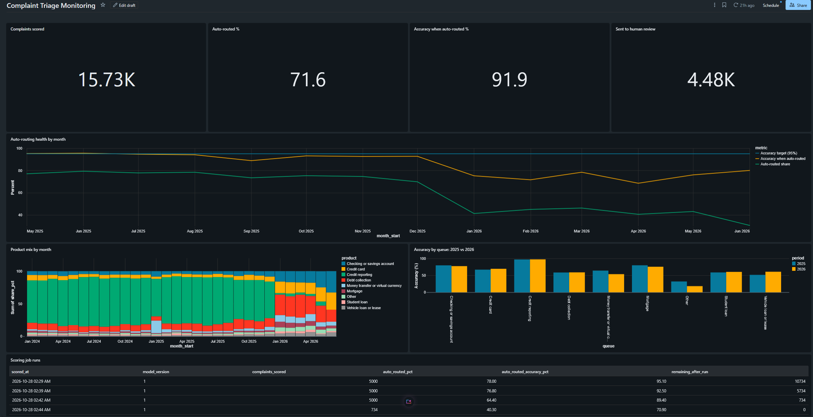
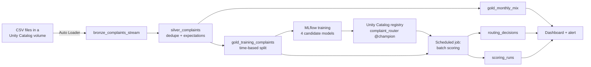

# Complaint Triage on Databricks

An end-to-end version of my [complaint triage project](https://github.com/Austintay226/complaint-triage) rebuilt on Databricks the way a team would run it in production: an incremental medallion pipeline with data quality rules, MLflow experiment tracking, a Unity Catalog model registry, a scheduled two-task scoring job, and a monitoring dashboard with an alert.

## What it does

Consumer financial complaints (about 40,000 real CFPB complaint narratives from 2024 to mid-2026) flow in as raw files, get cleaned and validated, and are used to train a model that routes each complaint to the right product team. A scheduled job scores new complaints: confident predictions are routed automatically, uncertain ones go to human review. A dashboard and an alert watch the system for drift.

## Architecture

| Layer | Databricks feature | File |
|---|---|---|
| Setup and raw load | Unity Catalog schema and volume, Delta tables, `read_files` | `sql/00_setup_and_bronze.sql` |
| Exploration | Notebooks, PySpark, Spark SQL, Delta time travel | `notebooks/01_explore_with_pyspark.py` |
| Pipeline | Lakeflow Spark Declarative Pipelines, Auto Loader, expectations | `pipeline/complaint_pipeline.py` |
| Training and registry | MLflow tracking, `search_runs`, Unity Catalog model registry, aliases | `notebooks/02_train_with_mlflow.py` |
| Batch scoring | Lakeflow Jobs (pipeline task then notebook task), widgets, `MERGE` | `notebooks/03_batch_scoring.py` |
| Monitoring | AI/BI dashboard, SQL alert | `sql/04_dashboard_and_alert_queries.sql` |

## Key design decisions

- **Medallion layers.** Bronze keeps raw data untouched so everything can be rebuilt; silver cleans and validates; gold holds model-ready and monitoring tables.
- **Declarative data quality.** Silver enforces rules as pipeline expectations: rows with an empty narrative or missing date are dropped; unknown products and badly parsed rows are kept but counted. Every run records pass and fail counts.
- **Template-letter de-duplication.** Copy-paste complaints filed under different IDs are collapsed to their earliest copy so the same text can't appear in both training and test data.
- **Split stored in gold.** The time-based train / validation / test split (65 / 15 / 20 by date, plus a 2026 holdout) is a column in the gold table, so training, scoring and evaluation always use identical rows.
- **Selection rule fixed in advance.** The model with the best validation macro-F1 wins; the test set is used once, after selection.
- **Aliases for promotion and rollback.** Jobs load `complaint_router@champion`. Promoting or rolling back a model means moving the alias, not changing code. The auto-routing threshold is stored as a tag on the model version so it travels with the model.
- **Incremental, idempotent scoring.** The job scores only complaints without a decision (left anti join) and writes with `MERGE`, so reruns and retries never score a complaint twice. Each decision records the model version that made it.

## Results

**Pipeline:** 40,838 complaints loaded (38,622 from 2024 to 2025, 2,216 from 2026) and reconciled against the source. All 40,838 passed the drop rules; the source files had already been cleaned upstream.

**Model selection (validation set):**

| Model | Val accuracy | Val macro-F1 |
|---|---|---|
| Naive Bayes | 85.1% | 0.622 |
| Logistic Regression, C=1 | 87.2% | 0.668 |
| **Logistic Regression, C=5 (selected)** | 88.3% | 0.716 |
| Logistic Regression, C=5, balanced | 86.1% | 0.714 |

**Test set (selected model, threshold chosen on validation for a 95% target):** 84.3% accuracy, 0.704 macro-F1; 74.8% of complaints auto-routed at 92.5% accuracy.

**Reproducibility check:** the original local Python version reached 84.2% accuracy and 0.701 macro-F1 with the same model and selection rule. Rebuilding the pipeline on a different platform, with Spark doing the cleaning and splitting, reproduced the results within 0.3 points.

## Monitoring: what the scoring job revealed

The job scores the oldest complaints first, so its run log doubles as a timeline:

| Scoring run | Period covered | Auto-routed | Accuracy when auto-routed |
|---|---|---|---|
| 1 | mid-2025 | 78.0% | 95.1% |
| 2 | 2025 | 76.8% | 92.5% |
| 3 | late 2025 | 64.4% | 89.4% |
| 4 | 2026 | 40.3% | 70.9% |

By month, accuracy held at 81% to 89% through 2025 and fell to 61% to 68% in 2026, while the auto-routed share fell from about 75% to below 50%. The dashboard's per-queue chart shows why: accuracy for each product barely changed, but the mix did. Credit reporting, the model's easiest queue, fell from about 60% of complaints to about 3%. This is **label shift**, not model degradation, the same finding as the original project.

Two monitoring lessons:
- **Confidence is a label-free early warning.** In production the true product arrives later, but the auto-routed share is known the moment a complaint is scored, and it dropped at the same time as accuracy.
- **An alert closes the loop.** A SQL alert fires when the latest run's auto-routed accuracy falls below 93%; it would have flagged the drift by the second run.

## From learning project to production

This is production practice at learning scale, on Databricks Free Edition with about 40,000 rows. A real deployment would add:

- **Separate environments** (development, staging, production) with CI/CD, for example Databricks Asset Bundles deployed by GitHub Actions
- **Service principals and least-privilege permissions** instead of a personal account
- **Ground-truth feedback:** analyst corrections joined back to decisions to measure accuracy on live traffic, feeding retraining
- **Automated threshold recalibration** when the product mix moves
- **Real-time serving** through a model serving endpoint, if routing must happen the moment a complaint arrives

## About this project

I built this to learn Databricks hands-on, with AI assistance writing much of the code. I set up the workspace, ran every stage, debugged issues on the real platform, and analyzed the results. The design decisions and findings above are what I can speak to in depth.

## How to run it

1. Produce `complaints_sample.csv` and `complaints_2026.csv` with the [original project](https://github.com/Austintay226/complaint-triage) (`download_data.py`, then `prepare_data.py`).
2. In a Databricks workspace, run `sql/00_setup_and_bronze.sql`, uploading the two CSVs to the `raw_files` volume when prompted.
3. Run `notebooks/01_explore_with_pyspark.py` (optional exploration).
4. Create an ETL pipeline with default catalog `workspace` and schema `complaint_triage`, paste in `pipeline/complaint_pipeline.py`, and run it.
5. Run `notebooks/02_train_with_mlflow.py` to train, register and alias the model.
6. Create a job with two tasks: the pipeline, then `notebooks/03_batch_scoring.py` (parameters `batch_size`, `model_alias`). Run it until no complaints remain.
7. Build the dashboard and alert from `sql/04_dashboard_and_alert_queries.sql`.
